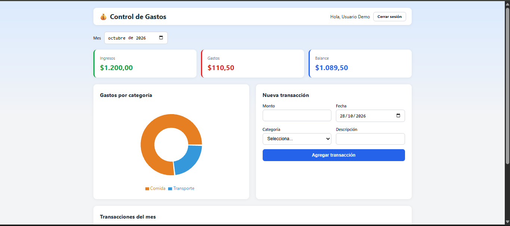
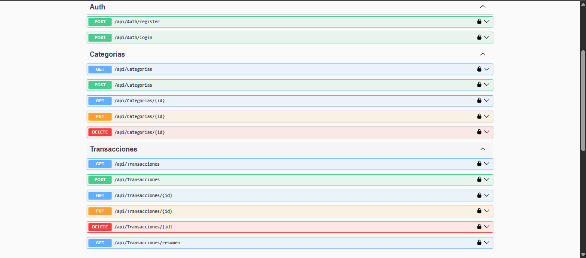
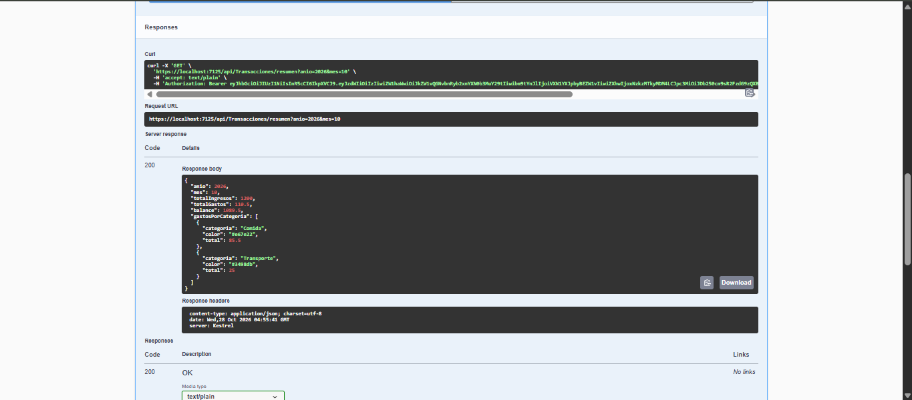

# 💰 Control de Gastos

Aplicación web para gestionar finanzas personales: registra ingresos y gastos, organízalos por categorías y consulta un resumen mensual con gráficos.

## Tecnologías

**Backend**

- C# / ASP.NET Core 9 (Web API)
- Entity Framework Core + SQL Server
- Autenticación con JWT y contraseñas con BCrypt
- Swagger (documentación interactiva)

**Frontend**

- React + Vite
- React Router
- Recharts (gráficos)

**Infraestructura**

- Docker y Docker Compose
- Nginx (para servir el frontend)

## Funcionalidades

- Registro e inicio de sesión de usuarios
- Dashboard con ingresos, gastos y balance del mes
- Gráfico de gastos por categoría
- Alta y baja de transacciones desde la interfaz
- Filtro por mes
- Cada usuario solo ve sus propios datos

## Capturas

### Dashboard



### Documentación de la API (Swagger)



### Resumen mensual (respuesta de la API)



## Endpoints principales

| Método       | Ruta                       | Descripción                      |
| ------------ | -------------------------- | -------------------------------- |
| POST         | /api/auth/register         | Crear cuenta                     |
| POST         | /api/auth/login            | Iniciar sesión (devuelve token)  |
| GET / POST   | /api/categorias            | Listar y crear categorías        |
| PUT / DELETE | /api/categorias/{id}       | Editar y borrar categoría        |
| GET / POST   | /api/transacciones         | Listar (con ?anio=&mes=) y crear |
| PUT / DELETE | /api/transacciones/{id}    | Editar y borrar transacción      |
| GET          | /api/transacciones/resumen | Resumen mensual                  |

## Ejecutar con Docker (recomendado)

Solo necesitas [Docker Desktop](https://www.docker.com/products/docker-desktop/). No hace falta instalar .NET, Node ni SQL Server.

1. Clona el repositorio y entra a la carpeta del proyecto.
2. Crea tu archivo de variables a partir de la plantilla:
   ```
   copy .env.example .env
   ```
   (en Linux o Mac: `cp .env.example .env`)
3. Abre `.env` y cambia los valores:
   - `DB_PASSWORD`: contraseña de SQL Server (mínimo 8 caracteres, con mayúsculas, minúsculas y números; sin `;`, `=` ni espacios).
   - `JWT_KEY`: una clave aleatoria de más de 32 caracteres.
4. Levanta todo:
   ```
   docker compose up --build
   ```
5. Abre la aplicación:
   - Web: http://localhost:3000
   - API y Swagger: http://localhost:8080/swagger

Para apagar los contenedores conservando los datos: `docker compose down`.
Para apagarlos y borrar también la base de datos: `docker compose down -v`.

## Ejecutar sin Docker

### Requisitos

- .NET 9 SDK
- SQL Server (por ejemplo, SQL Server Express)
- Node.js (versión LTS)

### Backend

1. Entra a `backend/ControlGastos.Api`.
2. En `appsettings.json`, ajusta la cadena de conexión a tu servidor de SQL Server.
3. Configura la clave del token (se guarda fuera del repo):
   ```
   dotnet user-secrets init
   dotnet user-secrets set "Jwt:Key" "una-clave-aleatoria-de-mas-de-32-caracteres"
   ```
4. Crea la base de datos:
   ```
   dotnet ef database update
   ```
5. Ejecuta con `dotnet run`. La API queda en `https://localhost:7125` y Swagger en `/swagger`.

### Frontend

1. Entra a `frontend`.
2. Instala las dependencias y ejecuta:
   ```
   npm install
   npm run dev
   ```
3. Abre `http://localhost:5173`, crea una cuenta y empieza a registrar movimientos.

## Pruebas

El backend tiene pruebas unitarias con xUnit y una base de datos en memoria (no requieren SQL Server):

- Resumen mensual: totales de ingresos, gastos y balance, y agrupación por categoría
- Aislamiento entre usuarios: nadie ve los datos de otra cuenta
- Validaciones: mes inválido y categorías ajenas
- Autenticación: registro, correo duplicado, login correcto e incorrecto

Para ejecutarlas:

```
cd backend/ControlGastos.Tests
dotnet test
```

## Próximos pasos

- [x] API REST con autenticación
- [x] Frontend con dashboard y gráficos
- [x] Pruebas unitarias
- [x] Docker
- [ ] Despliegue en la nube

## Autor

Danny Chilan · [GitHub](https://github.com/Dannych17)
